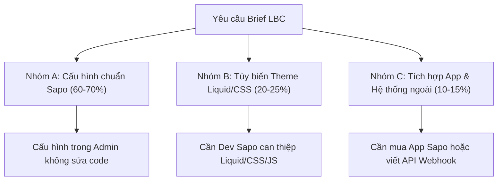

# TÀI LIỆU CHUYỂN GIAO THIẾT KẾ CHO ĐỐI TÁC TRIỂN KHAI SAPO WEB (SAPO HANDOFF)
**Dự án:** Website Lạc's Beauty Center  
**Tên miền:** lbcgroup.vn  
**Giao diện mua trên Sapo Theme Store:** Bean Pharmacity (Mr. Bean Themes)  
**Tài liệu tham chiếu cấu hình:** `https://bean-pharmacity.mysapo.net/huong-dan-su-dung`  
**Ngày lập:** 23/10/2026  

---

## 1. MỤC ĐÍCH VÀ NGUYÊN TẮC CHUYỂN GIAO

Bản prototype demo này là một giải pháp trực quan độc lập nhằm phục vụ Ban Giám đốc và đội ngũ dự án duyệt bố cục, thẩm định trải nghiệm người dùng (UX) và thống nhất phạm vi chức năng trước khi ký hợp đồng triển khai với đối tác kỹ thuật Sapo.

> [!WARNING]
> **Tuyên bố giới hạn kỹ thuật:**
> - Bản demo prototype **KHÔNG thể nhập (import) trực tiếp** vào nền tảng Sapo.
> - Bản demo được xây dựng để **mô phỏng chính xác hành vi và diện mạo mong muốn**, đồng thời làm căn cứ kỹ thuật để bóc tách khối lượng công việc (Scope of Work - SOW), dự toán chi phí tùy biến và nghiệm thu sản phẩm thực tế trên Sapo Web.
> - Không tuyên bố giao diện demo đã tương thích 100% với cấu trúc mã nguồn Liquid của Sapo nếu chưa qua bước can thiệp mã nguồn của chuyên viên kỹ thuật Sapo.

---

## 2. PHÂN LOẠI CÁC THÀNH PHẦN THEO MỨC ĐỘ TÙY BIẾN KỸ THUẬT

Dựa trên khảo sát cấu trúc thực tế của theme **Bean Pharmacity** và đối chiếu với 14 sheet trong file Brief, toàn bộ các hạng mục trên website được phân chia thành 3 nhóm rõ ràng:

---

### NHÓM A — CÓ THỂ MÔ PHỎNG BẰNG CẤU HÌNH / MODULE THÔNG THƯỜNG TRÊN SAPO
*Đặc điểm: Có thể thực hiện 100% thông qua giao diện quản trị Sapo (`Tùy chỉnh giao diện`, `Cấu hình theme`, `Menu`, `Trang nội dung`, `Blog`) mà không cần lập trình viên sửa mã nguồn.*

| STT | Thành phần | Vị trí trong Admin Sapo | Hướng dẫn cấu hình chuyển giao | Khối lượng dự kiến |
|---|---|---|---|---|
| **A.1** | **Bảng màu nhận diện & CSS cơ bản** | Thiết lập chung > Màu sắc | Đổi màu chủ đạo sang `#0E7C86`, màu hover `#0A4F57`, màu nền body phụ `#EEF7F8`. | 0.5 ngày |
| **A.2** | **Logo & Favicon** | Thiết lập chung > Logo & Favicon | Upload file logo ngang PNG nền trong cho header và logo trắng cho footer. Cài đặt Favicon 512×512. | 0.5 giờ |
| **A.3** | **Thanh thông báo trên cùng** | Thiết lập đầu trang > Banner top | Bật banner top, chọn ảnh nền dải màu `#0E7C86`, nhập link dẫn tới `/dat-lich-kham`. | 1 giờ |
| **A.4** | **Hotline & Lời chào thương hiệu** | Thiết lập đầu trang > Top bar slider | Nhập số Hotline phòng khám và 3 dòng lời chào: *(1) LBC xin chào, (2) Hướng đến Y học Cá nhân hóa, (3) Tiên phong công nghệ cao*. | 1 giờ |
| **A.5** | **Hero Slider chính + 2 Banner phụ** | Trang chủ > Module Slider | Bật slider Swiper, cấu hình 3-5 slide desktop/mobile và 2 banner phụ bên phải theo khung `slider_1.jpg` và `banner_right_1.jpg`. | 0.5 ngày |
| **A.6** | **Khối Giá trị cốt lõi** | Trang chủ > Module Chính sách | Kéo thả module Chính sách lên vị trí ngay dưới slider. Nhập 4 ô nội dung kèm icon đã vẽ. | 2 giờ |
| **A.7** | **Khối Giới thiệu phòng khám** | Trang chủ > Module Giới thiệu | Nhập nội dung giới thiệu 100 từ, upload 1 ảnh sảnh lớn và 3 ảnh hoạt động, cập nhật số liệu y khoa. | 0.5 ngày |
| **A.8** | **Khối Hệ sinh thái 5 Chuyên khoa** | Trang chủ > Module Banner 1 | Cấu hình 5 thẻ trượt (Da liễu, Xét nghiệm, Nhà thuốc, Dược mỹ phẩm, Đào tạo), upload 5 ảnh khu vực thật. | 0.5 ngày |
| **A.9** | **Khối Thương hiệu Dược mỹ phẩm** | Trang chủ > Module Thương hiệu | Upload logo các thương hiệu (Bioderma, Biotrade, PostQuam...), gắn nhãn "Phân phối chính hãng", link về trang thương hiệu. | 0.5 ngày |
| **A.10** | **Khối Sản phẩm tiêu biểu** | Trang chủ > Module Tab Sản phẩm 1 | Chọn các danh mục hiển thị theo tab (Làm sạch, Trị mụn, Phục hồi, Chống nắng, Sáng da). Tắt nhãn flash sale. | 0.5 ngày |
| **A.11** | **Khối Tin tức & Hoạt động** | Trang chủ > Module Tin tức | Trỏ module tới Blog tin tức, chọn hiển thị tab bài mới, chăm sóc da, hoạt động phòng khám. | 2 giờ |
| **A.12** | **Chân trang (Footer)** | Thiết lập chân trang | Nhập tên pháp nhân đầy đủ, số GPHĐ, ĐKKD, địa chỉ 2 cơ sở, danh sách cột liên kết, nhúng mã bản đồ và logo Bộ Công Thương. | 0.5 ngày |
| **A.13** | **Ẩn các module không dùng** | Trang chủ > Sắp xếp module | Đặt trạng thái "Không dùng" cho: Flash Sale, Coupon, Sản phẩm theo bệnh lý, Popup sale ảo, Tải app... | 1 giờ |
| **A.14** | **Trang nội dung thông thường & Chính sách** | Website > Trang nội dung | Tạo các trang tĩnh: Giới thiệu (`page.about`), Giấy phép (`page`), Câu hỏi thường gặp (`page.faq`), 5 trang Chính sách pháp lý. | 1 ngày |

---

### NHÓM B — CÓ THỂ CẦN CHỈNH SỬA THEME HOẶC VIẾT THÊM CSS/JAVASCRIPT
*Đặc điểm: Theme gốc chưa có sẵn giao diện đúng yêu cầu hoặc hiển thị chưa tối ưu. Cần đối tác kỹ thuật can thiệp vào mã nguồn Liquid, SCSS và JavaScript của theme.*

| STT | Hạng mục cần tùy biến | Hạn chế của Theme gốc | Giải pháp kỹ thuật trên Sapo | Ước tính công việc Dev |
|---|---|---|---|---|
| **B.1** | **Mega Menu Chuyên khoa 5 cột có icon** | Theme chỉ hỗ trợ menu đa cấp dạng danh mục sản phẩm đơn thuần, không có layout 5 cột kèm icon và mô tả riêng cho từng chuyên khoa. | Can thiệp file `header.liquid` và `main.scss.css`. Xây dựng cấu trúc HTML lồng ghép 5 cột với icon SVG/PNG, tên khoa và mô tả ngắn. | 1.5 – 2 ngày làm việc |
| **B.2** | **Khối Đội ngũ Bác sĩ 4 thẻ ngang trên Trang chủ** | Theme chỉ có Module Tin tức 2 hiển thị dạng 1 bài lớn + danh sách nhỏ bên cạnh, không có module hiển thị 4 thẻ card bác sĩ nằm ngang cân đối. | Tạo một section mới (ví dụ `section_doctors.liquid`) trong theme, query danh sách 4 bài viết trong blog `doi-ngu-bac-si` để render layout 4 card ngang đều nhau trên desktop, dạng slider vuốt trên mobile. | 1.5 – 2 ngày làm việc |
| **B.3** | **Bộ lọc & Trình so sánh Before – After** | Theme không có tính năng kéo thanh trượt (slider compare) để so sánh ảnh trước và sau điều trị; không có bộ lọc ca điều trị theo dịch vụ. | Tích hợp thư viện JavaScript nhẹ (như `image-compare-viewer` hoặc code so sánh 2 lớp ảnh bằng CSS clip-path). Thêm bộ lọc tag trong template blog `ket-qua-dieu-tri`. | 2 ngày làm việc |
| **B.4** | **Nút CTA "ĐẶT LỊCH KHÁM" ghim cố định trên Mobile** | Theme chỉ có nút cố định hỗ trợ mua hàng hoặc hotline gọi điện thông thường. | Viết thêm mã CSS cố định (fixed bottom bar) tại `main.scss.css` hiển thị nút Đặt lịch khám và Hotline trên thiết bị di động, có logic ẩn khi mở bàn phím để tránh che form. | 0.5 ngày |
| **B.5** | **Nhúng phông chữ Fraunces & Be Vietnam Pro** | Theme Sapo giới hạn danh sách font trong Admin. Không có sẵn phông Fraunces (serif sang trọng cho Heading da liễu cao cấp). | Chèn mã `<link rel="stylesheet" href="https://fonts.googleapis.com/css2?family=Be+Vietnam+Pro:wght@400;500;600;700&family=Fraunces:wght@600;700&display=swap">` vào thẻ `<head>` của `theme.liquid`. Khai báo `@font-face` và gán biến `--font-heading` trong SCSS. | 0.5 ngày |
| **B.6** | **Mục lục bài viết tự động (Table of Contents)** | Mặc dù theme có hỗ trợ TOC trong blog, cần đảm bảo script hoạt động mượt mà với các tiêu đề H2, H3 trong cả bài viết Dịch vụ và bài Tin tức. | Tinh chỉnh script TOC trong `article.liquid` để tự động bóc tách các thẻ H2/H3 và cuộn mượt (smooth scroll) đến đoạn tương ứng khi click. | 1 ngày làm việc |
| **B.7** | **Bố cục chuẩn y khoa cho 9 bài Dịch vụ điều trị** | Template bài viết mặc định chỉ hiển thị văn bản cuộn dài thông thường, thiếu các khối cấu trúc như: Quy trình các bước, Công nghệ ứng dụng, Bác sĩ tham vấn, FAQ riêng của dịch vụ. | Thiết kế một custom template `article.service.liquid` có sẵn các vùng hiển thị cấu trúc (accordion FAQ, timeline quy trình, box bác sĩ tham vấn). | 2 ngày làm việc |

---

### NHÓM C — CẦN XÁC MINH KHẢ NĂNG HỖ TRỢ, ỨNG DỤNG (APP) HOẶC TÍCH HỢP HỆ THỐNG RIÊNG
*Đặc điểm: Vượt ra ngoài phạm vi giao diện tĩnh của theme. Cần kết nối dịch vụ bên thứ ba, cài đặt app trên Sapo App Store hoặc lập trình tích hợp API.*

| STT | Nghiệp vụ cần tích hợp | Vấn đề kỹ thuật | Giải pháp đề xuất cho Sapo | Ghi chú & Rủi ro |
|---|---|---|---|---|
| **C.1** | **Form Đặt lịch khám kết nối CRM / Pancake / Email** | Mặc định form trên Sapo chỉ gửi email thông báo tới hòm thư quản trị, không có cơ chế phân loại lead theo cơ sở, dịch vụ và rất dễ bị trễ hoặc rơi vào hộp thư rác (Spam). | 1. Cài đặt App **"Biểu mẫu khảo sát Sapo"** hoặc **"Form Builder"**. 2. Viết webhook đẩy dữ liệu từ form trực tiếp vào hệ thống quản lý tin nhắn Pancake / CRM phòng khám. 3. Tự động gửi SMS/Zalo ZNS xác nhận lịch hẹn cho khách hàng. | Cần phòng khám cung cấp tài khoản Pancake/CRM và cấu hình webhook API. |
| **C.2** | **Đồng bộ dữ liệu Tồn kho & Đơn hàng với KiotViet** | Phòng khám có thể đang quản trị bán lẻ dược mỹ phẩm trên KiotViet tại cơ sở. | Sử dụng App tích hợp Sapo - KiotViet hoặc đồng bộ qua file Excel theo định kỳ. | Nếu chỉ bán kênh phụ, có thể quản lý tồn kho độc lập trên Sapo Web để tránh xung đột mã SKU. |
| **C.3** | **Tích hợp Cổng thanh toán & Đơn vị vận chuyển** | Cần giấy phép kinh doanh và hợp đồng ký kết với cổng thanh toán (VNPay, MoMo, ZaloPay) và nhà vận chuyển (GHTK, GHN, Viettel Post). | Kích hoạt các cổng thanh toán có sẵn trong Sapo Web sau khi hoàn tất thủ tục pháp lý và tài khoản doanh nghiệp. | Đối với giai đoạn đầu, có thể ưu tiên phương thức COD (thanh toán khi nhận hàng) và chuyển khoản ngân hàng qua mã VietQR. |
| **C.4** | **Đo lường chuyển đổi (GA4, Meta Pixel, TikTok Pixel, Google Ads)** | Cần đo lường chính xác các sự kiện: Click hotline, Submit form đặt lịch, Bấm chat Zalo, Thêm vào giỏ. | Cài đặt Google Tag Manager (GTM) vào `theme.liquid`. Tạo các trigger sự kiện cho các nút CTA trọng điểm. | Đảm bảo tuân thủ chính sách bảo vệ dữ liệu cá nhân của người dùng. |
| **C.5** | **Đăng ký Website Thương mại điện tử với Bộ Công Thương (online.gov.vn)** | Do website có tính năng giỏ hàng và đặt mua dược mỹ phẩm trực tuyến, bắt buộc phải làm thủ tục thông báo với Bộ Công Thương. | Cần hoàn thiện đầy đủ 5 trang chính sách (Bảo mật, Thanh toán, Vận chuyển, Đổi trả, Điều khoản) trước khi nộp hồ sơ. Chèn logo Bộ Công Thương kèm link xác thực sau khi được duyệt. | Trách nhiệm thuộc bộ phận Pháp chế / Marketing phòng khám; Sapo chỉ hỗ trợ vị trí đặt logo. |

---

## 3. CHECKLIST KIỂM THỬ KHI NHẬN BÀN GIAO TỪ ĐỐI TÁC SAPO

Đội ngũ dự án Lạc's Beauty Center sẽ sử dụng checklist sau để nghiệm thu sản phẩm thực tế trên Sapo dựa trên bản prototype demo:

- [ ] **Màu sắc & Nhận diện:** Toàn bộ hệ thống nút bấm, thanh điều hướng, tiêu đề tuân thủ đúng mã màu `#0E7C86` và `#0A4F57`.
- [ ] **Phông chữ tiếng Việt:** Tiêu đề hiển thị đúng font Fraunces, nội dung hiển thị Be Vietnam Pro, không bị lỗi dấu tiếng Việt trên cả Windows, macOS, iOS và Android.
- [ ] **Độ sạch của giao diện:** Đã tắt 100% các thành phần nhà thuốc không phù hợp: Flash Sale, mã giảm giá BUY2025, popup bán hàng ảo, mua thuốc theo đơn.
- [ ] **Mega Menu:** Mega menu 5 Chuyên khoa hiển thị chuẩn 5 cột có icon; Menu 9 Dịch vụ trỏ đúng vào các bài viết chi tiết.
- [ ] **Khối Bác sĩ:** Hiển thị 4 thẻ bác sĩ nằm ngang cân đối trên desktop, có đầy đủ học vị sau đại học và nút xem hồ sơ.
- [ ] **Khối Before/After:** Hình ảnh trước sau hiển thị rõ nét, có dòng cảnh báo kết quả tùy cơ địa.
- [ ] **Form Đặt lịch:** Kiểm tra gửi thử dữ liệu, xác nhận lead về đúng email và hệ thống tiếp nhận trong vòng dưới 30 giây.
- [ ] **Responsive:** Kiểm tra trên điện thoại di động (iPhone, Samsung) không bị vỡ bố cục, không tràn ngang, thanh CTA đặt lịch cố định bấm nhạy và tiện lợi.
- [ ] **Footer:** Hiển thị đầy đủ thông tin pháp nhân CÔNG TY TNHH VIỆN CHĂM SÓC DA LẠC'S BEAUTY CENTER và địa chỉ 2 cơ sở.
